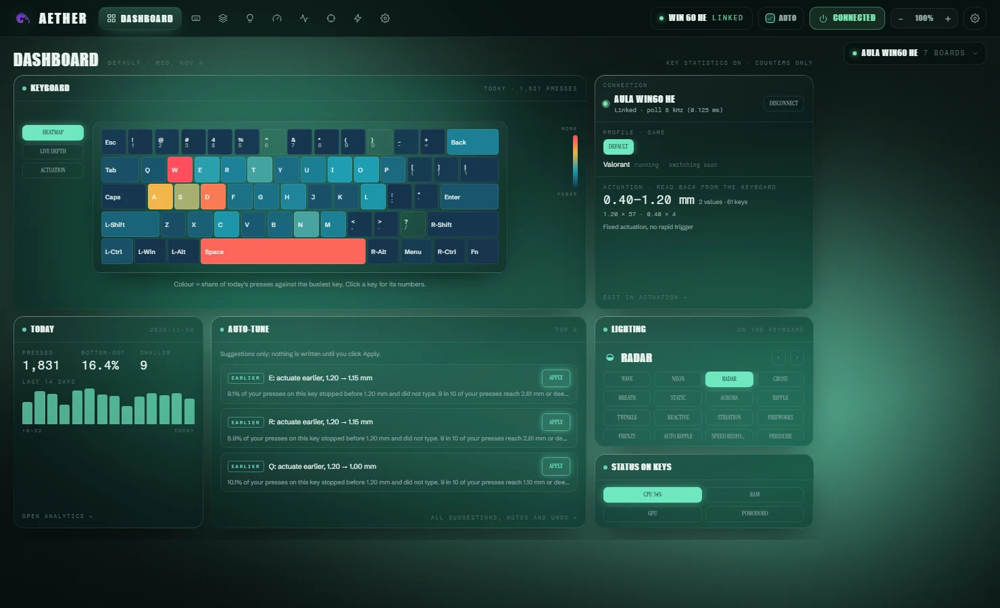
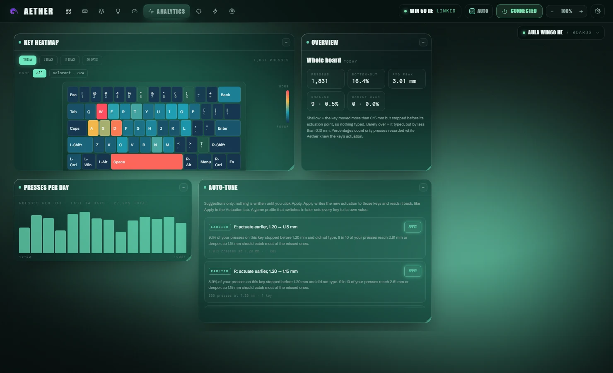
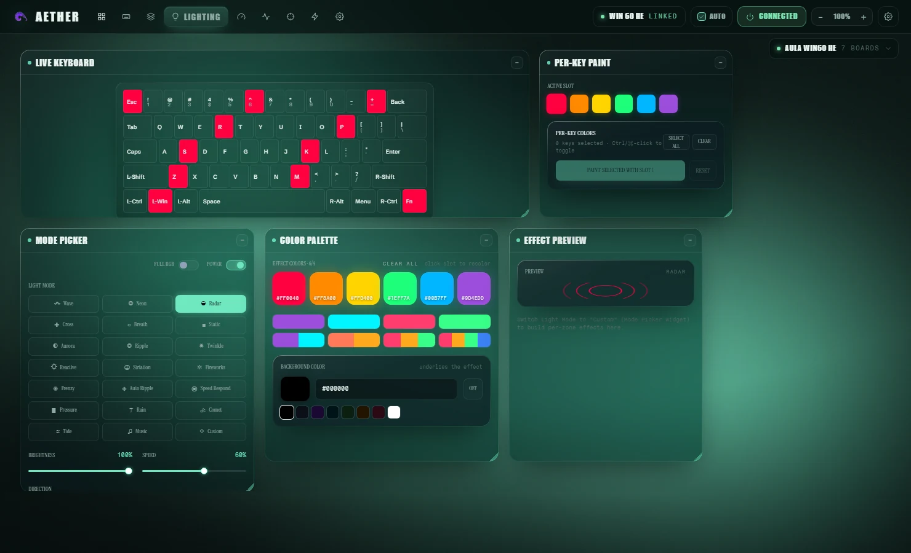
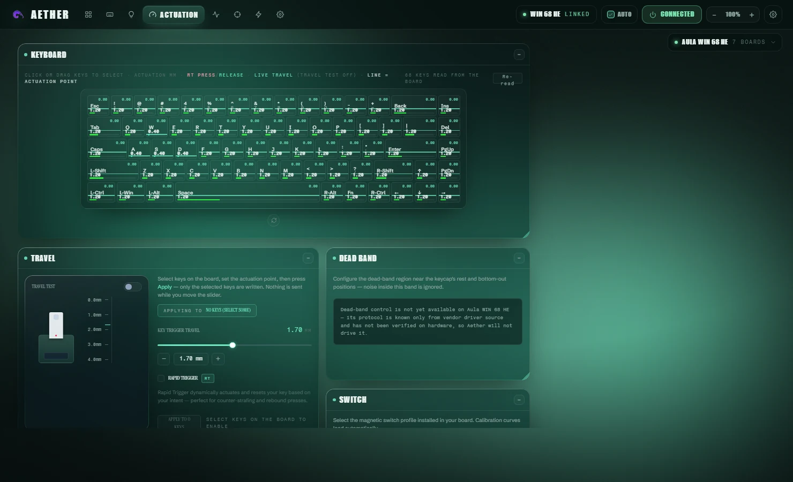
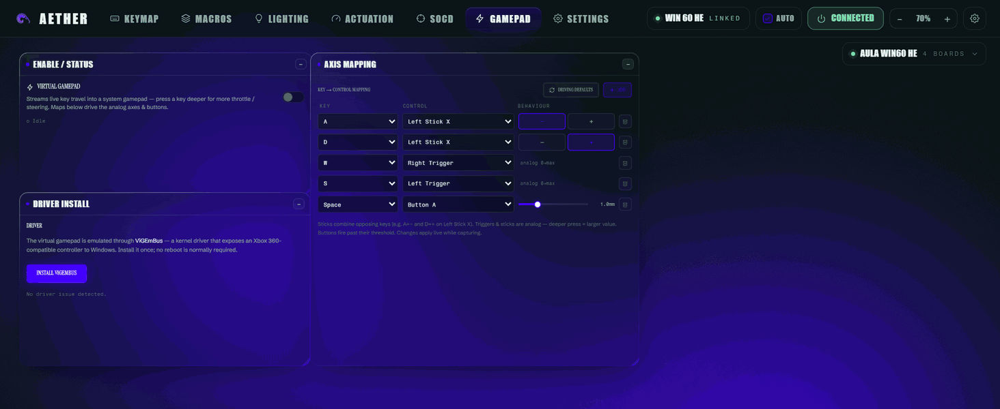

# Aether HE

**One open, local app for your Hall-effect keyboard. No account, no telemetry,
no bloat.**

Aether controls the lighting, actuation, Rapid Trigger, SOCD, macros and more on
Hall-effect keyboards, replacing the heavy, online-only or data-hungry apps that
ship with them. It runs entirely on your computer, it is free and open source
(GPL-3.0), and it grows one keyboard at a time with help from the people who own
them.

> ### → [**Download the latest release**](https://github.com/MrWhosNexus/Aether-HE/releases/latest)
> Windows: `AetherHE-Setup.exe` · Linux: `AetherHE.flatpak`.
> Aether updates itself on launch (if you allow it) and checks every download's
> SHA-256 before running it.



## Why Aether

- **Yours, and local.** No sign-in, no cloud, no analytics, no ads. Settings and
  statistics stay in one folder on your PC. The app only goes online to check
  GitHub for updates and to fetch Discord's public list of game names
  ([what exactly](PRIVACY.md)).
- **Light.** One small native window instead of a browser-based vendor suite and
  its background services. Close it and it waits in the tray; your lighting
  keeps running.
- **Many keyboards, one app.** Every supported board gets the same features, and
  features the stock software never had.
- **Built with owners.** Send your board's details and a short capture, and its
  support gets built from that. Owners who want to go deeper decode features,
  port tools and add things their stock app lacks.
- **Open and checked.** GPL-3.0 source; community code is scanned and reviewed
  before it ships, and nothing a contributor sends is ever run automatically
  ([security](SECURITY.md)).

## What it does

| | |
|---|---|
| **Dashboard** | Today's heatmap, live key depth or each key's actuation point on one screen, with connection, profile, game, lighting and suggestions. |
| **Key statistics & Analytics** | Per-key presses, bottom-outs and depth over 1–30 days, filterable by game. Counts only: never what you type, the order of keys or when you pressed them. |
| **Actuation suggestions** | Spots keys you press too shallow or barely past the actuation point and suggests a better value. Nothing is written until you press Apply. |
| **Actuation & Rapid Trigger** | Per-key actuation point, RT press/release, dead band and switch profile, read back from the keyboard and drawn on every key. |
| **Travel Test & calibration** | Live depth of every key as you press, and guided calibration. |
| **Lighting** | All firmware modes plus multi-color, per-key host effects at up to 60 fps: Pressure (glow follows depth), Music (bars follow what your PC plays), Rain, Fireworks, zones and per-key paint. |
| **Status on keys** | CPU, RAM and GPU load and a Pomodoro timer as bars on the key rows. |
| **Game profiles** | Detects a running game and switches to the profile you picked for it, then back when you quit. |
| **SOCD, remap, macros** | SOCD pairs (incl. last-input-wins), key remaps and firmware macros that work with the app closed. |
| **Virtual gamepad** | Hall-effect travel as Xbox 360 sticks and triggers (ViGEmBus on Windows, uinput on Linux). |
| **Tray & mini mode** | Runs from the tray with a small effect panel; optional start-minimized. |

## Screenshots

### Analytics: which keys you use, and how deep, per game


### Lighting: firmware modes and host-streamed effects


### WIN 68 HE: the full 68-key board, actuation read back per key


### Gamepad: Hall-effect travel as a controller


<sub>Screenshots use demo data.</sub>

## Supported keyboards

<!-- BOARDS:START -->
| Keyboard | Switches | Lighting | Actuation | Status |
|----------|----------|----------|-----------|--------|
| Aula Win60 HE | Hall-effect | ✅ | ✅ | Fully supported — hardware-verified |
| Aula MINI 60 HE PRO (wired) | Hall-effect | ✅ | ✅ | Fully supported — hardware-verified (#6) |
| Aula MINI 60 HE PRO (2.4 GHz dongle) | Hall-effect | ✅ | ✅ | Supported over RF — firmware effects only, no host streaming (#6) |
| Aula WIN 68 HE | Hall-effect | 🚧 | 🚧 | Bring-up — auto-detected, shares the Win60 protocol; full 68-key layout and live travel confirmed from an owner's capture (#20), settings not yet round-tripped on hardware |
| **Your board?** | — | — | — | **[Submit it →](https://github.com/MrWhosNexus/Aether-HE/issues/new?template=add-a-board.yml)** |

**Recognised, but not drivable yet.** Aether identifies these boards, names them and draws their layout, but has no verified protocol for them — lighting and actuation stay switched off and they are not offered as selectable options anywhere in the app: **Aula KP-TE153** (Recognised and drawn from the vendor's own 69-key UK ISO layout, and it shares the Win60's protocol by USB identity — but no physical KP-TE153 has ever been driven by Aether, and the ISO PRCS hidCode remap leaves SOCD unverified for it. Not offered as a selectable board.), **Aula MINI60HE Max** (protocol decoded from a capture but never proven on hardware (#4)), **Aula MINI 60 HE PRO (alt PID 0x80B2)** (second hardware revision, no capture of its own (#6)), **Aula MINI 68 HE** (listed by the vendor driver, no capture), **Aula MINI 68 HE PRO** (listed by the vendor driver, no capture), **Aula MINI68 HE MAX** (listed by the vendor driver, no capture), **AULA F75 HE** (listed by the vendor driver, no capture), **Aula MINI60HE / MINI68HE MAX (2.4 GHz dongle)** (different transport from the decoded wired boards, no capture), **Aula Win60 HE Max** (layout added, needs captures (#5)), **Aula WIN 68 HE Max** (protocol decoded from a vendor-driver capture (#7): lighting and per-key colour drive when plugged in; actuation, live travel and SOCD wait for a hardware bring-up. Not offered in the picker until then.), **Aula WIN 60 HE Pro** (SayoDevice silicon (8089:0009). protocol_sayo reproduces the contributor's captures byte-for-byte, but nobody working on Aether owns this board, so no frame from Aether has ever reached one. Recognised, named and drawn; not offered.), **Aula F75 Tri-Mode** (in the registry, needs captures (#8)).
<!-- BOARDS:END -->

> This table is generated from [`data/boards.json`](data/boards.json)
> (`python tools/gen_boards_table.py --write`).

## Add your keyboard

**Own a Hall-effect or RGB keyboard Aether doesn't drive yet? Send its data.**
It takes a few minutes and no coding.

1. Open the **[Add-a-keyboard form](https://github.com/MrWhosNexus/Aether-HE/issues/new?template=add-a-board.yml)**,
   or use **Settings → Submit a board** in the app (it records a short,
   read-only capture and opens a pre-filled issue; don't type anything private
   while it records, the file is public).
2. Include the exact model, USB VID:PID, the vendor software you use, and a
   top-down photo. Captures of lighting or actuation changes made in the vendor
   app speed things up a lot.
3. Support gets built from your data and goes out as *bring-up*; you test it,
   and it becomes *supported* once it works on your board.

Want to go further? Decode features, write packet builders and layouts, add
features your stock software lacks, and help test other owners' boards. Read
**[CONTRIBUTING.md](CONTRIBUTING.md)** (GPL-3.0 with a DCO sign-off; no vendor
code, only your own work) and [docs/SUBMIT_A_BOARD.md](docs/SUBMIT_A_BOARD.md).

<details>
<summary>Board-draft bot (maintainers)</summary>

`.github/workflows/board-bot.yml` drafts board support from a submission with an
AI model (MiniMax), **only** when a maintainer adds the `bot-draft` label to the
issue. The run is bound to the issue text as it was when labelled, follows only
immutable GitHub uploads, and opens a draft PR that commits **data only** (a
registry entry with no driver, plus the layout); the drafted adapter is shown in
the PR body as text for a human to review and port. It never merges. Setup: repo
secret `MINIMAX_API_KEY`.
</details>

## Install: Windows

1. Download **`AetherHE-Setup.exe`** from
   [Releases](https://github.com/MrWhosNexus/Aether-HE/releases) and run it.
   The installer shows the license and notices, installs to
   `Program Files\AetherHE`, adds shortcuts and an uninstaller, and can install
   the ViGEmBus driver for the virtual gamepad.
2. Launch Aether and connect your keyboard from the top-right button.

Portable: `AetherHE-windows.zip`, extract anywhere and run `AetherHE.exe`.

<details>
<summary>Build from source</summary>

```bat
py -3.12 -m venv venv-web
venv-web\Scripts\pip install -r requirements.txt pyinstaller
build_installer.bat
```

Produces `dist\AetherHE-Setup.exe`, `dist\AetherHE\AetherHE.exe` and
`dist\AetherHE-windows.zip` (Inno Setup 6 needed for the installer:
`winget install JRSoftware.InnoSetup`). Run from source with `run.bat`.
</details>

## Install: Linux

**Flatpak (recommended):**

```sh
flatpak install --user flathub org.gnome.Platform//49      # if not present
flatpak install --user AetherHE.flatpak                    # from Releases
flatpak run io.github.mrwhosnexus.AetherHE
```

Install the udev rules on the host as well (step 3 below).

<details>
<summary>From source (no Flatpak)</summary>

Tested on CachyOS / Arch; any distro with GTK 3, WebKit2GTK and Python 3.10+.

```sh
# 1. System deps (Arch / CachyOS; adjust for your distro)
sudo pacman -S python python-gobject webkit2gtk libusb

# 2. App venv (--system-site-packages so the GTK bindings resolve)
python -m venv --system-site-packages venv-web
venv-web/bin/pip install -r requirements.txt

# 3. udev: device access + uinput (gamepad) without sudo
sudo cp 99-aula.rules 99-uinput.rules /etc/udev/rules.d/
sudo udevadm control --reload-rules && sudo udevadm trigger
sudo usermod -aG input "$USER"       # then log out and back in

# 4. Run
./run.sh
```

Build the Flatpak: `flatpak run org.flatpak.Builder --force-clean --user --install --repo=flatpak/repo flatpak/build-dir flatpak/io.github.mrwhosnexus.AetherHE.yml`.
</details>

## Updates

**Settings → Updates** (or on launch, if enabled) checks GitHub Releases. On
Windows the installer runs silently and relaunches Aether; on Flatpak the bundle
is installed on the host, then restart. Downloads come only from this
repository's releases and are verified against GitHub's SHA-256.

<details>
<summary>Cutting a release (maintainer)</summary>

Bump `version.py` (and `installer.iss`, the Flatpak metainfo), then
`git tag vX.Y.Z && git push origin vX.Y.Z`. `.github/workflows/release.yml`
builds the Windows installer and the Flatpak and publishes them on the release.
</details>

## Privacy, security and legal

- **[PRIVACY.md](PRIVACY.md):** everything Aether stores and every network
  request it makes.
- **[SECURITY.md](SECURITY.md):** how to report a vulnerability, and how
  updates, submissions and contributions are protected.
- **[NOTICE.md](NOTICE.md):** Aether is an independent project, **not
  affiliated with or endorsed by Aula or any keyboard maker**. It is provided
  **without warranty**: writing settings to a keyboard carries risk, and
  boards marked bring-up or experimental are unverified. Some games and
  tournaments **ban SOCD / Snap Tap, Rapid Trigger, macros or remaps**;
  following their rules is up to you.
- **[AI_DISCLOSURE.md](AI_DISCLOSURE.md):** much of Aether is written with AI
  assistance under human direction and review. No AI runs inside the app.
- **[THIRD_PARTY_NOTICES.md](THIRD_PARTY_NOTICES.md):** bundled open-source
  components and their licenses.

## Architecture

- **`app_web.py`**: pywebview shell and the `Api` bridge exposed to the UI as
  `window.pywebview.api` (connect, lighting, actuation, SOCD, remap, macros,
  calibration, gamepad, statistics, games, overlays, updates).
- **`drivers/`, `protocol*.py`**: per-board drivers and packet builders, chosen
  from a fixed table by `data/board_registry.json`.
- **`device_state.py`**: `KeyMap` (key index ↔ design code ↔ position, mapped by
  key name), the live travel reader and the calibration reader.
- **`effects.py`**: host-driven per-key effect engine (up to 60 fps).
- **`telemetry.py`, `analytics.py`**: per-key counters and the suggestions
  built from them (counts only).
- **`games.py`, `overlays.py`, `music.py`, `tray.py`**: game profiles, status on
  keys, the music visualizer and tray residency.
- **`gamepad.py`**: key travel → virtual gamepad (uinput / ViGEmBus).
- **`ui/runtime_src/`**: React/Tailwind source, precompiled into
  `ui/index_runtime.html` by `build_runtime.py` (no Node, nothing loaded from
  the internet).

<details>
<summary>Aula Win60 HE protocol cheat-sheet (verified on hardware)</summary>

- **Lighting (cmd 7):** `[5]=mode, [6]=bri, [7]=speed, [8:10]=fg, [11:13]=bg,
  [14]=dir, [15]=fullColor, [16]=power`. Modes: static 0, breath 1, wave 2,
  neon 3, radar 4, reactive 6, aurora 7, ripple 8, twinkle 9, custom 10,
  cross 11, speed-respond 12, auto-ripple 14, striation 15, fireworks 16.
  Direction: right 0, left 1, up 2, down 3, spread 4, gather 5.
- **Per-key RGB (cmd 9):** 396-byte table in 54-byte pages.
- **Actuation (cmd 33):** mode 0 fixed, 12 Rapid Trigger, 13 RT with separate
  press/release; 0.01 mm units, 0.08–3.4 mm. Travel stream:
  `idx = r[7]*22 + r[8]`, `depth = (r[9] | r[10]<<8) / 100`.
- **Calibration:** cmd 33 sub `r[6] ∈ {8, 15}`; calibrated-key bitmask in `r[8:30]`.
- **Macros (cmd 25):** 10 slots × 256 B; bound to a key through the base keymap.
</details>

## License

Aether HE is free software under the **GNU General Public License v3.0 or
later**: see [LICENSE](LICENSE). Copyright (C) 2026 MrWhosNexus and the Aether
HE contributors.
